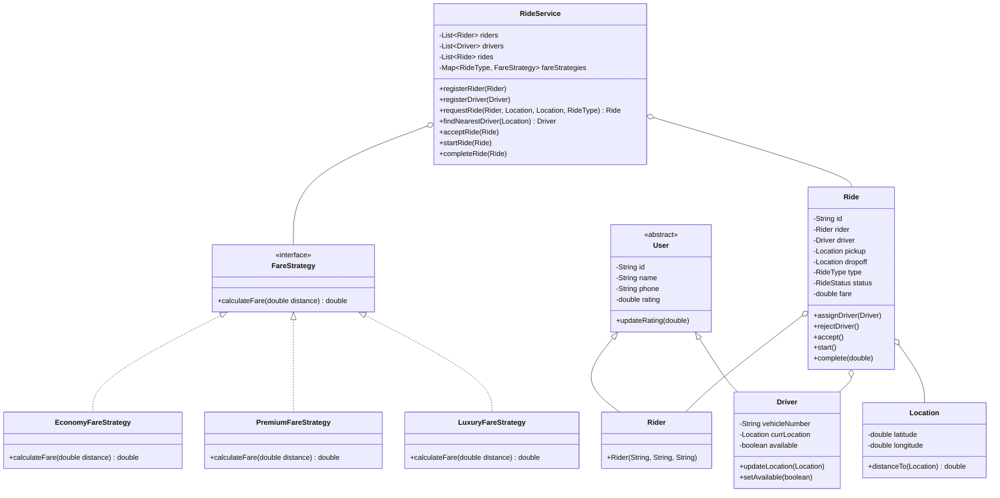
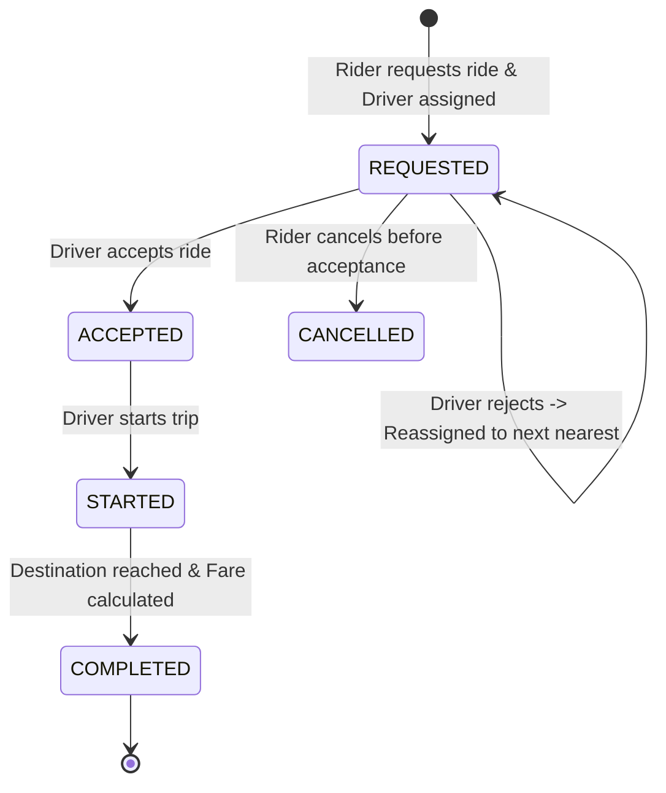

# 🚗 Ride Sharing System - Low Level Design (LLD)

A robust, modular, and extensible Low-Level Design (LLD) implementation of an on-demand Ride-Sharing Service (similar to Uber / Lyft / Ola) in Java. This project demonstrates core Object-Oriented Design (OOD) principles, SOLID design principles, and design patterns.

---

## 📌 Table of Contents
- [Overview](#overview)
- [Requirements & Features](#requirements--features)
- [Design Patterns & OOP Principles](#design-patterns--oop-principles)
- [Architecture & Class Diagram](#architecture--class-diagram)
- [Ride Lifecycle & State Flow](#ride-lifecycle--state-flow)
- [Project Structure](#project-structure)
- [Getting Started](#getting-started)
- [Sample Execution Output](#sample-execution-output)

---

## 📖 Overview

The Ride Sharing System allows riders to request rides between locations, dynamically matches them with the nearest available driver, calculates fares based on vehicle tiers using the **Strategy Pattern**, and manages the lifecycle of a ride through strict state validation.

---

## ⚡ Requirements & Features

1. **User Management:**
   - Abstract `User` base class with shared attributes (ID, name, phone, rating).
   - `Rider`: Requests rides and completes trips.
   - `Driver`: Has vehicle registration number, real-time location, and availability state (`available / occupied`).

2. **Driver Matching Algorithm:**
   - Finds the nearest available driver using Euclidean distance calculation based on coordinates (`Location`).
   - Automatically marks drivers as unavailable once assigned and resets them to available upon trip completion.
   - Supports re-assigning to the next closest driver if a driver rejects the ride.

3. **Flexible Pricing (Strategy Pattern):**
   - Supports multiple ride tiers: **Economy**, **Premium**, and **Luxury**.
   - Each tier has its own pricing rules (base fare + per-km charge).
   - Easily extensible to add surge pricing or peak-hour pricing without modifying existing code (Open/Closed Principle).

4. **Lifecycle State Management:**
   - Enforces valid state transitions: `REQUESTED` ➔ `ACCEPTED` ➔ `STARTED` ➔ `COMPLETED`.
   - Prevents invalid actions (e.g., cannot start a ride before it is accepted, cannot complete a ride that has not started).

---

## 🧩 Design Patterns & OOP Principles

- **Strategy Pattern (`FareStrategy`):**
  Defines a family of algorithms for fare calculation (`EconomyFareStrategy`, `PremiumFareStrategy`, `LuxuryFareStrategy`) and encapsulates each one. `RideService` can calculate fares dynamically at runtime based on `RideType` without hardcoding if-else trees.

- **State Management:**
  Guarantees deterministic lifecycle transitions using `RideStatus` enum with validations at each lifecycle step.

- **SOLID Principles:**
  - **Single Responsibility Principle (SRP):** Each class has a single purpose (e.g., `Location` handles coordinate distances, `RideService` manages orchestration, `FareStrategy` computes fares).
  - **Open/Closed Principle (OCP):** New fare strategies or ride types can be added without modifying existing fare logic.
  - **Liskov Substitution Principle (LSP):** `Rider` and `Driver` derive from `User` and can seamlessly substitute the base class.
  - **Interface Segregation Principle (ISP):** Small, focused interfaces like `FareStrategy`.
  - **Dependency Inversion Principle (DIP):** High-level modules interact with the `FareStrategy` abstraction rather than concrete implementations.

---

## 📐 Architecture & Class Diagram



---

## 🔄 Ride Lifecycle & State Flow



---

## 📁 Project Structure

```
Ride-Sharing-LLD/
├── src/
│   ├── Driver.java              # Driver entity extending User
│   ├── EconomyFareStrategy.java # Economy tier pricing strategy
│   ├── FareStrategy.java        # Strategy pattern interface for fare calculation
│   ├── Location.java            # Latitude/Longitude & distance calculation
│   ├── LuxuryFareStrategy.java  # Luxury tier pricing strategy
│   ├── PremiumFareStrategy.java # Premium tier pricing strategy
│   ├── Ride.java                # Core Ride entity & state transition logic
│   ├── Rider.java               # Rider entity extending User
│   ├── RideService.java         # Service layer orchestrating rides & drivers
│   ├── RideSharingApp.java      # Application entry point / Driver demo
│   ├── RideStatus.java          # Enum: REQUESTED, ACCEPTED, STARTED, COMPLETED, CANCELLED
│   ├── RideType.java            # Enum: ECONOMY, PREMIUM, LUXURY
│   └── User.java                # Abstract base class for all users
├── .gitignore                   # Git ignore file for Java & IDE files
└── README.md                    # Project documentation
```

---

## 🚀 Getting Started

### Prerequisites
- Java Development Kit (JDK 17 or higher recommended)
- Git

### Build & Run

1. **Clone the repository:**
   ```bash
   git clone https://github.com/gitsofpranav/Ride-Sharing-LLD.git
   cd Ride-Sharing-LLD
   ```

2. **Navigate to the `src` directory:**
   ```bash
   cd src
   ```

3. **Compile all Java source files:**
   ```bash
   javac *.java
   ```

4. **Run the demo application:**
   ```bash
   java RideSharingApp
   ```

---

## 🖥️ Sample Execution Output

```text
Ride booked successfully!
Ride ID: RIDE-d0afadd1-206f-4ef8-a3b1-b7d646d1e221
Driver: Ramu
Status: REQUESTED
Driver accepted the ride!
Ride started!
Ride completed!
Final fare: 10.027513632984386
Final Status: COMPLETED
```
